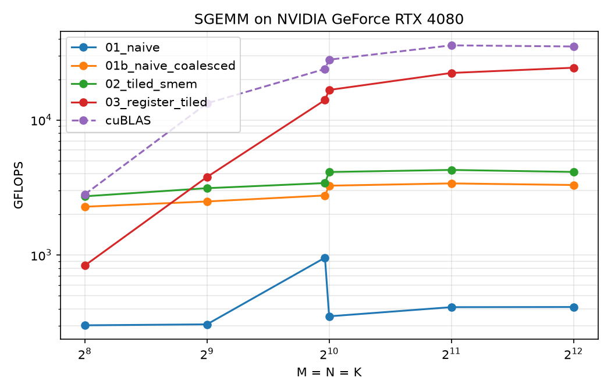
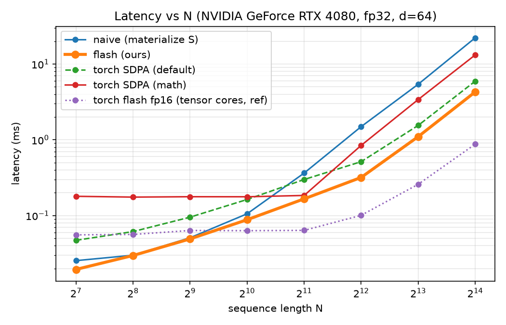
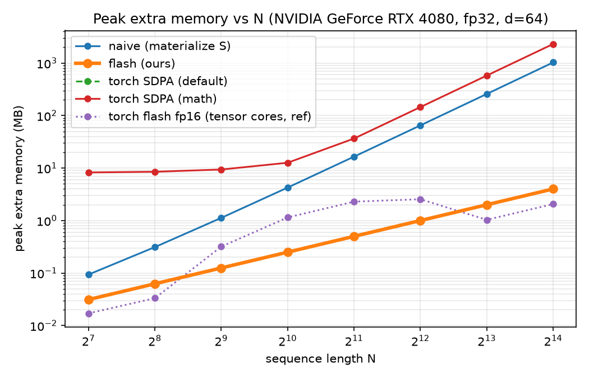

# GPU kernels from naive GEMM to Flash Attention

Hand-written CUDA, fp32, no libraries in the kernels: a GEMM optimisation ladder (naive → coalesced →
shared-memory tiled → register tiled) and a Flash Attention forward kernel with tiled online softmax,
benchmarked against a naive attention that materialises the N×N score matrix and against PyTorch.

**Hardware / software:** NVIDIA GeForce RTX 4080 (Ada, sm_89, 76 SMs, fp32 peak ≈ 48.7 TFLOPS), CUDA 13.1,
PyTorch 2.15 (cu132). The GPU was shared with another user's process (~10 GB resident), so absolute numbers
carry some noise; timings are medians of repeated runs.

## 30-second summary

| | result |
|---|---|
| GEMM, 4096³ | naive **0.41** → register-tiled **24.4 TFLOPS** = **70 % of cuBLAS** (59× speed-up) |
| Attention memory, N = 16384 | naive **1028 MB** (∝ N²) vs flash **4 MB** (∝ N, just the output) |
| Attention speed, N = 16384 | flash **4.3 ms / 16.1 TFLOPS** vs naive 22.2 ms (5.2×) and PyTorch fp32 SDPA 5.9 ms |
| Correctness | max abs error ≈ 4e-7 vs an fp64 reference on normal inputs (tolerance 1e-4); 58 test rows pass |
| Honest caveat | PyTorch's *fp16 tensor-core* FlashAttention is **4.9× faster** than mine (78 TFLOPS) — see [why](#why-im-slower-than-real-flashattention-and-faster-than-pytorchs-fp32-path) |

## Repo layout

```
common/        check_cuda macro, CUDA-event timer, shared GEMM host driver
gemm/          00_hello, 01_naive, 01b_naive_coalesced, 02_tiled_smem, 03_register_tiled
attention/     naive_attention.cu, flash_fwd.cu (shared libs, C API), attn_lib.py (ctypes bindings)
tests/         test_gemm.py, test_attention.py
bench/         bench_gemm.py, bench_attention.py, static_resources.py
scripts/       remote.sh (sync+run on the GPU box), pull_results.sh, profile_gemm.sh (ncu)
results/       tables, plots, logs
```

Build and run (needs `nvcc`, Python ≥ 3.10 with CUDA PyTorch + matplotlib):

```sh
make                                              # builds build/ (GEMM binaries + attention .so)
python tests/test_gemm.py build/01_naive build/02_tiled_smem build/03_register_tiled
python tests/test_attention.py
python bench/bench_gemm.py && python bench/bench_attention.py
```

The Makefile includes a workaround for glibc ≥ 2.41 + CUDA 13.1, whose headers clash over `rsqrt`
(see the comment in `Makefile`). Kernel inputs are random normal tensors generated in the harness.

## Part 1 — GEMM

All kernels are verified against an **fp64** `A@B` for M×N×K ∈ {128³, 1000³, 513×257×129, 64×1000×33, 1024³}
(non-multiples of every tile size exercise the boundary handling) with `rtol=1e-4, atol=1e-3`. Max abs error is
2e-4 at 1000³ for every kernel (fp32 accumulation over K = 1000).

### Optimisation table (square, N = 4096; cuBLAS = `torch.matmul`, TF32 off, 35.0 TFLOPS)

| step | change | GFLOPS | % cuBLAS | bottleneck it addresses | evidence |
|---|---|---:|---:|---|---|
| 01 naive | one thread per C element, `threadIdx.x` ↔ row | 412 | 1.2 % | A reads and C writes are strided: each warp touches 32 different rows | *measured*: fixing only this gives 8× (next row) |
| 01b coalesced | `threadIdx.x` ↔ column; still no shared memory | 3,297 | 9.4 % | per-thread re-reading of A/B through L1/L2 | *measured*: tiling adds only 1.25× on top |
| 02 tiled smem | 32×32 tiles of A, B staged in shared memory | 4,120 | 11.8 % | shared-memory *load issue*: 2 LDS per FMA | *derived*: see below; *tested*: block-size hypothesis rejected |
| 03 register tiled | 128×128 block tile, 8×8 patch per thread, A stored transposed | 24,352 | 69.6 % | LDS:FMA ratio 2:1 → 1:4 | *derived* + static resources; remaining gap below |

Speed-ups: 01→01b **8.0×**, 01b→02 **1.25×**, 02→03 **5.9×**; cumulative **59×**.
Full table over N ∈ {256 … 4096} is in [`results/gemm.md`](results/gemm.md); plot: `results/gemm.png`.



### What the measurements say (and what they don't)

* **Coalescing, not shared memory, is the big first win here.** With only the index swap, the naive kernel
  gets 8×; shared-memory tiling then adds 25 %. The textbook story "tiling cuts global traffic by TILE×" is true
  but, on Ada's large L1/L2, coalesced re-reads are already cheap.
* **Tiled kernel at ~4 TFLOPS.** Each FMA needs two shared-memory loads (`As[ty][k]` broadcast, `Bs[k][tx]`). An SM can
  issue ~1 warp-wide LDS per clock vs 4 warp-wide FMAs, which caps this kernel at 1/8 of peak ≈ **6.1 TFLOPS**
  (measured 4.1). That is consistent with an LDS-bound kernel. I first suspected barrier stalls from the
  1024-thread blocks (1 block/SM); changing to 16×16 tiles (256 threads, several blocks/SM) gave 3,913 vs 3,779 GFLOPS at
  2048³ — essentially no change — so that hypothesis was **rejected**.
* **Register tiling at 33 % theoretical occupancy beats 67 % occupancy by 6×** (`results/gemm_static.md`: 118 regs/thread,
  8 KB smem, no spills, 2 blocks/SM). Instruction-level parallelism from 64 independent accumulators matters more than
  warps in flight.
* **Power-of-two anomaly:** the naive kernel is 955 GFLOPS at 1000³ but 351 at 1024³. Probably cache-set conflicts from the
  power-of-two row stride; I did not verify this.
* **Not measured: Nsight Compute counters.** On the DoC `gpu32` machine `ncu` fails with `ERR_NVGPUCTRPERM` (counters are
  admin-only), so achieved occupancy, warp execution efficiency, DRAM/L2 % of peak, bank conflicts and the roofline are
  **missing**. `scripts/profile_gemm.sh` collects exactly those (`ncu --set full` plus a metrics CSV) and
  is ready to run on a machine where counters are enabled. The "bottleneck" column above is therefore
  reasoning backed by timing ablations and compile-time resource usage, not profiler confirmation.
* **Remaining gap to cuBLAS (30 %)** — not investigated by profiling; candidates: scalar (not `float4`) global/shared
  loads, no double-buffered prefetch, low occupancy, no warp-level tiling.

## Part 2 — Flash Attention forward

`O = softmax(QKᵀ/√d) V`, fp32, single head, d = 64, optional causal mask.

### The algorithm (`attention/flash_fwd.cu`)

A block owns BR query rows; each row is handled by TPR cooperating threads that split the 64-wide head dimension
(interleaved `float4` chunks) and combine partial dot products with `__shfl_xor_sync`. K/V are streamed through shared
memory in tiles of BC rows, and for each tile every thread runs the online-softmax update from the plan:

```
s_j   = q · K_j                      (scale log2(e)/√d folded into q, so exp → exp2f)
m_new = max(m, max_j s_j);   alpha = exp2(m − m_new)
l     = alpha·l + Σ_j exp2(s_j − m_new)
o     = alpha·o + Σ_j exp2(s_j − m_new)·V_j
O     = o / l
```

Nothing of size N×N exists; extra memory is just the output. Out-of-range rows/columns are zero-filled and masked to
−∞, which handles N not a multiple of the tile. Causal masking skips whole K/V tiles beyond a block's last row.
The tile shape ⟨BR, BC, TPR⟩ was tuned over 16 configs at N ∈ {512 … 16384}; the default ⟨32, 32, 2⟩ is best or within 5 % of best
everywhere. Tuning result: fewer threads per row is better down to 2 (less shuffle traffic), but TPR = 1 collapses to
3–4.7 TFLOPS (probably register pressure from holding 64 `q` + 64 `o` values per thread, but I did not check the register counts).

`attention/naive_attention.cu` is the O(N²) baseline: three kernels (tiled QKᵀ, row softmax in place, tiled PV) with the
N×N scratch buffer allocated by the caller so PyTorch's allocator counts it.

### Correctness (`python tests/test_attention.py`, log in `results/test_attention.txt`)

Reference: fp64 PyTorch. Error = max |O − O_ref|. Both kernels, plus all 16 tile configs at N = 513 (causal and not).

| case | tolerance | flash max err | naive max err | torch fp32 SDPA (yardstick) |
|---|---|---|---|---|
| N ∈ {1, 7, 20, 64, 100, 513, 1024, 4096} (N < tile, non-multiples) | 1e-4 | 0 – 5e-7 | 0 – 5e-7 | 2e-7 – 1e-6 |
| causal, N ∈ {513, 4096} | 1e-4 | ≤ 5e-7 | ≤ 5e-7 | ≤ 1.4e-6 |
| large magnitude, scale 20 (|s| ~ 4e3) | 1e-3 | 1.0e-4 | 3.8e-4 | 3.7e-4 |
| large magnitude, scale 50 (|s| ~ 1e4) | 5e-3 | 2.5e-4 | 2.6e-3 | 1.0e-3 |

Max-subtraction works: no overflow/NaN at |s| ~ 1e4 (a naive `exp(s)` would overflow beyond 88).
**The large-magnitude tolerances are looser than the plan's 1e-4 on purpose:** fp32 rounding of a score `s` is ≈ 6e-8·|s|, and
`exp` turns that into the same relative error in the probabilities, so *any* fp32 implementation loses accuracy as |s| grows.
PyTorch's own fp32 SDPA is at 1.0e-3 in the worst case, which is why I printed it as a yardstick. Note the naive kernel
(2.6e-3) is 2.5× worse than PyTorch there, while the flash kernel (2.5e-4) is 4× better.

### Benchmarks (`python bench/bench_attention.py`; full tables in [`results/attention.md`](results/attention.md))

| N | naive ms | **flash ms** | torch SDPA fp32 ms | torch flash fp16 TC ms (ref) | naive MB | **flash MB** | torch math MB |
|---:|---:|---:|---:|---:|---:|---:|---:|
| 1024 | 0.105 | **0.088** | 0.163 | 0.063 | 4.2 | **0.2** | 12.6 |
| 4096 | 1.49 | **0.318** | 0.514 | 0.101 | 65 | **1.0** | 145 |
| 8192 | 5.40 | **1.10** | 1.55 | 0.259 | 258 | **2.0** | 578 |
| 16384 | 22.2 | **4.28** | 5.93 | 0.876 | 1028 | **4.0** | 2308 |

Peak memory = `torch.cuda.max_memory_allocated` minus the Q/K/V inputs (scratch + output). Throughput counts 4N²d FLOPs.
At N ≤ 256 every implementation runs in 20–60 µs and the numbers mostly measure launch overhead; I don't draw conclusions there.




**Headline:** naive memory quadruples when N doubles (a 16384-token fp32 score matrix is 1 GiB); flash memory only doubles
(it is the 4 MB output). "Torch SDPA (default)" uses the same memory as ours (it is also a fused kernel), so its line sits under ours.

## Why I'm slower than real FlashAttention (and faster than PyTorch's fp32 path)

The plan expected to lose to `F.scaled_dot_product_attention`. In fp32, I don't: **16.1 vs 11.6 TFLOPS** at N = 16384
(1.4×). I checked this rather than assume it was a quirk of the single-head setup:
PyTorch's fp32 default is its *memory-efficient* backend (the FlashAttention backend does not support fp32), and it stays at
~12 TFLOPS even with 16 heads, so it is a plain CUDA-core kernel with that ceiling, not under-occupied by my benchmark.
My result is real but narrow: one head, d = 64, fp32, forward only, no dropout, no variable lengths, no GQA, no logsumexp output
(needed for a backward pass), and it only supports d = 64.

Against **PyTorch's fp16 FlashAttention (tensor cores) I am 4.9× slower** (16 vs 78 TFLOPS at N = 16384). That row is a different
precision, so it's a reference, not a like-for-like comparison. What my kernel lacks:

1. **No tensor cores.** All math is scalar fp32 FMAs (33 % of the 48.7 TFLOPS fp32 peak at best); fp16/bf16 `mma` has a several-fold higher peak.
2. **No async copies / no pipelining.** K/V tiles are loaded synchronously, then `__syncthreads`, then computed — global-memory latency is not overlapped with compute (`cp.async` double buffering would).
3. **Redundant work from the thread layout.** With TPR = 2, both threads of a row compute every `exp2` and the softmax statistics, and every score costs a shuffle.
4. **Small-N parallelism.** One block per BR = 32 query rows with a single head: N = 512 launches 16 blocks on 76 SMs.
5. **No hand-tuned register blocking** across several query rows per thread to raise FMA:LDS ratio (the same lesson as GEMM step 4).

## What is not done

* Nsight Compute profiles and the roofline (blocked by GPU counter permissions; script provided).
* The optional Triton version.
* Backward pass, batching/heads, d ≠ 64.
